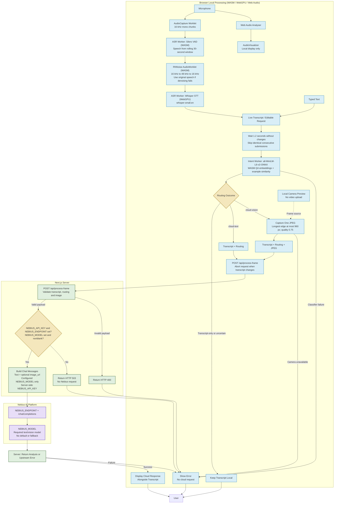

# Auralis

**Audio-Guided Vision Escalation Harness**

Auralis aims to reduce multimodal AI costs by running speech processing and routing decisions locally in the browser using WebGPU, WebAssembly, and Web Audio. Instead of uploading audio or video streams, Auralis routes transcript text to cloud reasoning only when needed and includes one camera JPEG only for visual requests.

## Architecture Overview



## How It Works

### 1. Local Audio Processing

Audio is processed entirely in the browser:

- Silero VAD detects speech activity using WASM in the ASR worker.
- RNNoise suppresses noise in detected speech through a WASM AudioWorklet. If suppression fails, transcription uses the original speech.
- `onnx-community/whisper-small.en` converts speech to text using WebGPU with an FP32 encoder and Q4 decoder. Audio transcription requires a WebGPU-enabled browser; there is no WASM fallback for Whisper.
- all-MiniLM-L6-v2-ONNX embeds text using WASM in the intent worker; similarity to labeled examples determines whether cloud escalation is required.

### 2. Intelligent Routing

The local classifier determines:

- Whether the request can be satisfied with transcription alone.
- Whether cloud reasoning is required.
- Whether visual information is necessary.

This minimizes unnecessary cloud calls and token consumption.

#### Implemented Local Router

The request panel accepts the latest live transcript or typed text and automatically classifies it after 1.2 seconds without changes. Only confident `cloud-text` or `cloud-vision` decisions trigger a cloud request; transcript-only and uncertain decisions stay local. Identical consecutive transcripts are not resubmitted. If classification is busy, the latest transcript is queued instead of starting overlapping work. Editing the transcript invalidates pending routing and aborts any in-flight cloud request, although an already accepted cloud request may still incur costs.

- A dedicated worker runs `onnx-community/all-MiniLM-L6-v2-ONNX` through Transformers.js on single-threaded WASM with Q4 weights. The initial download requires internet access; model files use the browser cache thereafter. Transcripts are embedded locally, not sent to Hugging Face.
- MiniLM is an embedding model, not a trained intent-classification head. Mean-pooled, normalized embeddings are compared against labeled examples in `utils/intent.ts` using cosine similarity.
- The camera streams locally while the page is open, after camera permission is granted; the stream is stopped when the page unmounts. `transcript-only` returns text locally. `cloud-text` sends only the transcript. Only `cloud-vision` captures and sends one JPEG capped at 960 pixels on its longest edge, without interrupting the preview. No video stream or periodic frames are uploaded. Camera access failures do not block text-only requests.
- A match needs similarity of at least `0.40` and a margin of at least `0.08` over the next intent. Ambiguous, empty, or overlong inputs stay local; model failures never fall back to a cloud call. Inputs are limited to 1,200 characters.
- These thresholds are conservative starting values, not calibrated probabilities. Validate and tune the examples and thresholds on representative English requests before production use, especially negation, mixed intents, and references to prior visual context.

The existing `/api/process-frame` endpoint now requires `{ transcript, routing: { requiresCloud: true, requiresVision: boolean }, image? }`. Images are accepted only for visual routes. Client routing is a cost-control policy, not an authentication or abuse-prevention boundary.

Configure `NEBIUS_API_KEY`, `NEBIUS_ENDPOINT`, and `NEBIUS_MODEL` on the server, for example `NEBIUS_ENDPOINT=https://api.tokenfactory.nebius.com/v1`. The route appends `/chat/completions`, allowing a trailing slash on the base endpoint. Set `NEBIUS_MODEL` to a supported text/vision model ID; no default model is used.

Run the routing and API contract tests with `node --test tests/intent.test.mjs`.

### 3. Conditional Vision Escalation

If visual understanding is needed:

1. The browser captures one frame from the live camera preview.
2. The frame is resized to at most 960 pixels on its longest edge and encoded as a JPEG at quality 0.75.
3. The JPEG is attached to the transcript and routing decision for the server request.
4. The configured cloud model interprets the image; no visual features are extracted locally.

Text-only requests do not capture or upload an image. The local camera preview remains live; no periodic frames or video streams are uploaded.

### 4. Context Packaging

The browser sends a JSON payload to `/api/process-frame` containing the transcript, routing decision, and an optional JPEG data URL:

```text
Transcript + Routing + Optional JPEG
            |
            v
     POST /api/process-frame
```

The server validates the payload and constructs chat messages containing text and, for visual requests, an `image_url`. Raw audio and video streams are never included.

### 5. Cloud Reasoning

The server forwards chat messages to the configured endpoint using server-only credentials:

```text
POST /api/process-frame
        |
        v
NEBIUS_ENDPOINT + /chat/completions
        |
        v
Model selected by NEBIUS_MODEL
        |
        v
Display Response + Local Transcript
```

`NEBIUS_API_KEY`, `NEBIUS_ENDPOINT`, and `NEBIUS_MODEL` are required. No fallback model is selected. Configure a vision-capable model for visual requests.

## Key Innovation

Auralis performs early decision-making locally before invoking cloud reasoning.

Potential benefits include:

- Reduced multimodal token consumption
- Lower cloud inference costs
- Reduced bandwidth usage
- Faster response times
- Increased privacy through local processing
- Efficient escalation of only the context required for reasoning

## Technology Stack

### Browser

- Web Audio / AudioWorklets for capture, visualization, and resampling
- Silero VAD on WASM
- RNNoise on WASM in an AudioWorklet
- Whisper Small English (`whisper-small.en`) on WebGPU
- all-MiniLM-L6-v2-ONNX on WASM with Q4 weights

### Server

- Next.js route handler at `/api/process-frame`
- Payload validation and authenticated forwarding using server-only environment variables

### Cloud

- Nebius-compatible chat completions at `NEBIUS_ENDPOINT`
- Text/vision reasoning using the explicitly configured `NEBIUS_MODEL`

## Third-Party Licenses

Bundled RNNoise assets retain their upstream licenses. Full license texts, copyright notices, source versions, and attribution are included in [the bundled noise-suppression notices](public/noise-suppressor/THIRD_PARTY_NOTICES.txt), also served at `/noise-suppressor/THIRD_PARTY_NOTICES.txt`. Keep that file with the assets when redistributing or deploying them. The project's root license does not replace these third-party terms.

## Example Flows

### Transcript-Only Flow

```text
User Speech
    |
    v
Silero VAD -> RNNoise -> Whisper Small English
    |
    v
Transcript -> Wait 1.2 seconds without changes
    |
    v
MiniLM Routing: Transcript-only or Uncertain
    |
    v
Keep Transcript Local
```

### Multimodal Reasoning Flow

```text
User Speech -> Silero VAD -> RNNoise -> Whisper Small English
          |
          v
Transcript (or Typed Text) -> Wait 1.2 seconds without changes
          |
          v
MiniLM Routing: cloud-vision
          |
          v
Capture One Resized Camera JPEG
          |
          v
Transcript + Routing + JPEG -> POST /api/process-frame
          |
          v
Validated Chat Messages -> NEBIUS_ENDPOINT + /chat/completions
          |
          v
Configured NEBIUS_MODEL -> Display Response + Local Transcript
```

## Value Proposition

**Auralis keeps speech processing and intent routing in the browser, sending only transcript text and, when needed, one camera JPEG to the configured cloud model. This limits uploads and avoids cloud calls for transcript-only or uncertain requests. Actual cost savings and response quality depend on the workload, routing thresholds, and selected model.**